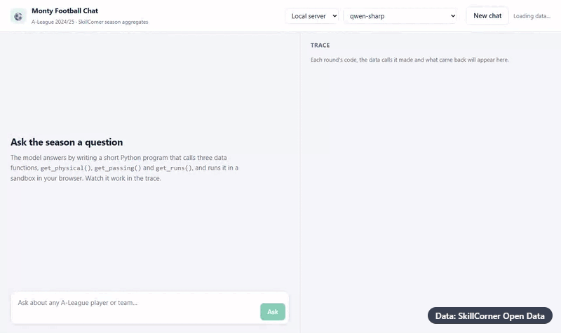

# Monty football chat

A browser app for chatting with football data, built around a pattern commonly known as code mode. The LLM
gets three fixed data functions over SkillCorner's 2024/25 A-League season aggregates (physical,
passing and off-ball runs). It answers each question by writing a short Python program that calls
and combines them, run in Pydantic's Monty sandbox inside your browser. A trace panel streams the
code as it's written, then shows each data call and its result. Bring your own LLM: OpenRouter
(free models work) or a local OpenAI-compatible server.

The data functions here are for demonstration only: the agent writes them during the build from
the prompt's description. The pattern depends on those functions being the trusted layer, since
they're the model's only way to the data and they handle the data's quirks. So for real use, write
them yourself, or at least spend real effort checking they're correct before relying on any answers.

## The prompt

[`idea.md`](idea.md). Paste it into your coding agent as-is, or adapt it.

## Building it

- Start your agent in an empty folder; it builds there.
- You need Node.js and a browser. The data is three small CSVs read straight from SkillCorner's GitHub when the
  page loads, so there's nothing to download first.
- For the chat you need either an OpenRouter account (sign in from the app; its free models work)
  or a local OpenAI-compatible server such as llama.cpp, Ollama or LM Studio. Adapt the prompt if you want another backend LLM method.
- Using Claude Sonnet as the idea implementer, a one-shot build takes **6–7 minutes** and costs **$1.05–$1.51** at
  pay-as-you-go API prices, generating about **41–48k tokens**.

## Example output

"Which centre forwards with at least 5 matches are in the top 10 for both runs in behind and top
speed?", answered by a local model in real time: one program, two data calls, and the answer
with the code alongside.

## Data

Season aggregates from [SkillCorner open data](https://github.com/SkillCorner/opendata) (MIT).
Please credit SkillCorner if you publish anything built from it.
